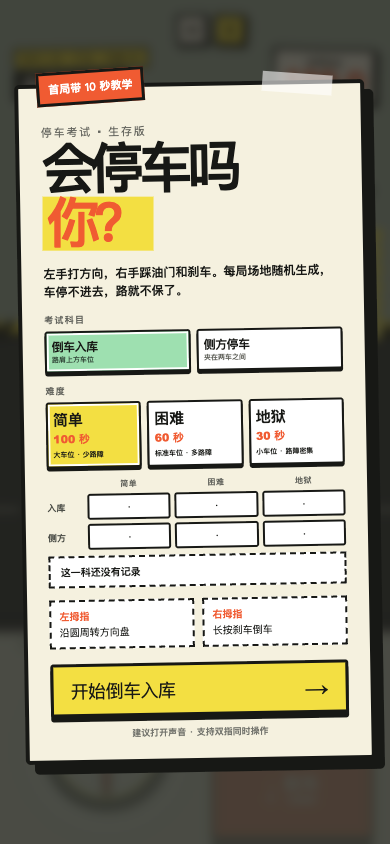
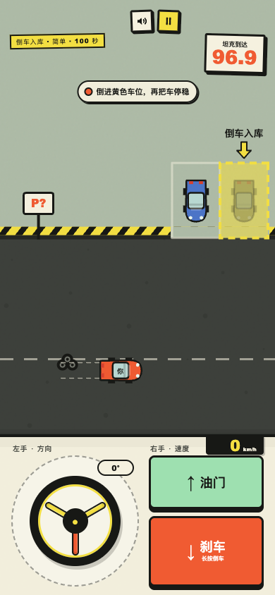
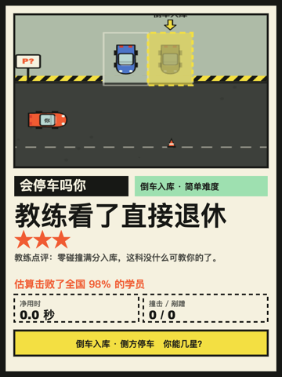

# 会停车吗你


一个为手机竖屏设计的零依赖停车网页小游戏，发布在小红书小工具上。倒车入库和侧方停车两个科目、简单困难地狱三个难度，每局场地随机生成，倒计时归零就有坦克开过来把场景碾碎。

项目只使用原生 HTML、CSS 和 JavaScript，不联网、不收集数据，也没有运行时依赖。除普通浏览器外，源码同时兼容小红书离线小工具容器。

| 开始页 | 游戏中 | 战绩图 |
| --- | --- | --- |
|  |  |  |

## 开始运行

需要 Node.js 18+ 和 Python 3。

```bash
npm run dev
```

浏览器打开 <http://127.0.0.1:4173>。如果需要更换端口：

```bash
PORT=8080 npm run dev
```

桌面端可用方向键测试，手机端支持方向盘和踏板双指同时触控。想对照旧版本，用 `VERSION_DIR=1_0_0 npm run dev`。

## 校验与打包

```bash
npm run check
npm run package
```

`npm run check` 检查运行文件完整性、容器合规性（不联网、无内联脚本、无外部资源）和版本号一致性。打包脚本还需要系统安装 `zip` 和 `unzip`，产物会写入 `dist/parking-game-v<版本号>.zip`，ZIP 根目录直接包含 `index.html`，可用于静态托管或小红书小工具上传。

## 项目结构

```text
parking-game/
├── 1_0_0/                 # 1.0.0 存档，不再改动
├── 1_1_0/                 # 当前开发版本，也是打包上传的内容
├── docs/
│   ├── GAMEPLAY.md        # 完整玩法与调参说明
│   └── assets/            # 图标与截图，不参与游戏运行
├── scripts/
│   ├── dev.sh             # 本地预览
│   ├── package.sh         # 生成离线 ZIP
│   └── validate.mjs       # 容器合规与资源完整性检查
├── VERSION                # 当前开发版本，决定脚本操作哪个目录
└── package.json           # 无依赖的项目命令入口
```

按版本号分目录，每个版本目录都是一份可以整体打包上传的完整产物，所以 README 和文档只留在仓库根目录。发布新版本时复制一份目录并更新 `VERSION`，旧目录作为存档保持原样。

生成的 `dist/`、本地 AI 工具配置和系统文件不会提交到仓库。

## 游戏说明

- 倒车入库：车位开在路肩上方，垂直于道路，两侧有邻车。
- 侧方停车：车位夹在路面上的前后两辆车之间，需要沿路方向摆正。
- 三个难度分别是 100 秒大车位、60 秒标准车位、30 秒小车位，路障数量依次增加。
- 正面撞击扣 2 秒，剐蹭只掉速；在倒计时内整车进入黄色车位、摆正并停稳即通关。
- 首次游玩有三步操作教学，教学期间不计时也不罚时。
- 成绩、星级和通关次数仅保存在浏览器 `localStorage` 中；结算页可以生成战绩图或复制战绩文案。

更完整的规则、场地生成逻辑和调参位置见 [玩法说明](docs/GAMEPLAY.md)。

## 参与贡献

欢迎提交问题和改进。开始前请阅读 [CONTRIBUTING.md](CONTRIBUTING.md)，安全问题请按 [SECURITY.md](SECURITY.md) 私下报告。

## 许可证

[MIT](LICENSE) © 2026 ai-graveyard contributors
